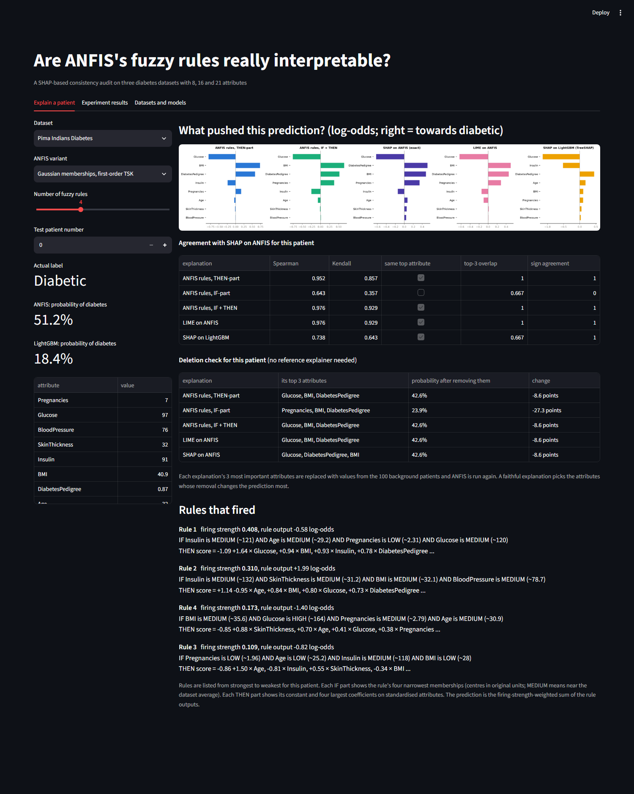
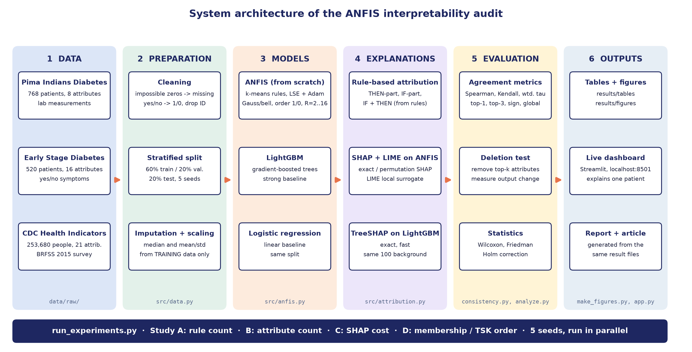

# Are ANFIS's Fuzzy Rules Really Interpretable?

**A SHAP-based consistency audit of neuro-fuzzy rule explanations on diabetes diagnosis**

ANFIS (Adaptive Neuro-Fuzzy Inference System) is often picked for medical prediction because it explains every
decision with IF-THEN rules. But a readable rule is not automatically a *faithful* one. This project checks whether
the explanation you read from a trained ANFIS rule base actually matches what drives its predictions.

For every test patient we turn the rule base into one importance score per attribute and compare it with SHAP and
LIME explanations of the **same model**, plus a deletion test that does not trust any explainer. We do this on three
real diabetes datasets with 8, 16 and 21 attributes, for rule bases of 2 to 16 rules and four ANFIS variants,
repeated over 5 random splits with proper significance testing.

Soft Computing project, School of Computer Science and Engineering, VIT-AP University.



## Main findings

| | Pima | Early Stage | CDC |
|---|---|---|---|
| ROC-AUC, ANFIS (4 rules) | 0.827 | 0.990 | 0.829 |
| ROC-AUC, LightGBM | 0.823 | 0.989 | 0.830 |
| ROC-AUC, logistic regression | 0.823 | 0.976 | 0.822 |
| Rule explanation (THEN-part) vs SHAP, Spearman | 0.75 | 0.54 | 0.86 |
| Same direction of effect as SHAP | 0.94 | 0.91 | 1.00 |
| Same top-3 attributes as SHAP | 0.77 | 0.56 | 0.79 |
| LIME vs SHAP, Spearman | 0.85 | 0.77 | 0.91 |
| THEN-part agreement, 2 rules → 16 rules | 0.83 → 0.74 | 0.69 → 0.51 | 0.80 → 0.78 |

- ANFIS is as accurate as LightGBM on all three datasets, so choosing it for its rules costs no accuracy.
- The rules get the **direction** of each effect right and point at attributes that really matter (removing them
  changes the prediction 1.8 to 3.4 times more than removing random ones), but the **order** of importance for a
  single patient matches SHAP only partly.
- More rules make the explanation significantly less faithful without improving accuracy, because the vote gets
  spread over more rules and more of the effect comes from *which* rules fire, which the rule formulas do not show.
- Early Stage is the hardest case: there one rule takes about 91% of the vote, so the rules behave almost like
  on/off switches. Bell membership functions or zero-order rules soften this and improve agreement there.

All differences above are tested with Wilcoxon signed-rank and Friedman tests with Holm correction
(`results/tables/significance.csv`).

## How it works



1. **Data** (`src/data.py`): load the three datasets, mark Pima's impossible zeros as missing, encode yes/no answers,
   split 60/20/20 (stratified), fill missing values with the training median and standardise using training data only.
2. **Model** (`src/anfis.py`): first-order TSK ANFIS written from scratch in NumPy. Rules are placed with k-means,
   firing uses the dimension-normalised geometric mean (HTSK), THEN parts start from ridge least squares and everything
   is trained with Adam and early stopping. Gaussian or bell memberships, first or zero order.
3. **Explanations** (`src/attribution.py`):
   - THEN-part: `phi_j = sum_r wbar_r * a_rj * x_j` (exact, adds up to the model output)
   - IF-part: `phi_j = sum_r wbar_r * (f_r - z) * (l_rj(x_j) - l_rj(mean))`, the effect of rule switching
   - SHAP on ANFIS (exact up to 10 attributes, permutation above), LIME (own implementation), TreeSHAP on LightGBM
   - Deletion test: remove each explanation's top-k attributes and measure the change in output
4. **Agreement** (`src/consistency.py`): Spearman, Kendall, weighted Kendall, top-1, top-3 overlap, sign agreement,
   global Spearman.
5. **Statistics** (`analyze.py`): Wilcoxon signed-rank, Friedman, Holm correction, rank-biserial effect sizes, and
   diagnostics that explain the results.

### Studies

| Study | What changes | Fixed |
|---|---|---|
| A. Rule count | 2, 3, 4, 6, 8, 12, 16 rules | all attributes |
| B. Attribute count | top-k attributes by mutual information | 4 rules |
| C. Explanation cost | black-box SHAP vs TreeSHAP vs LIME | 4 rules |
| D. Variants | Gaussian / bell × first / zero order | 4 rules |

## Datasets

| Dataset | Records | Attributes | Diabetic | Source |
|---|---|---|---|---|
| Pima Indians Diabetes | 768 | 8 | 35% | NIDDK |
| Early Stage Diabetes Risk | 520 | 16 | 62% | UCI ML Repository, id 529 |
| CDC Diabetes Health Indicators (BRFSS 2015) | 253,680 | 21 | 14% | UCI ML Repository, id 891 |

The raw files are in `data/raw/` exactly as downloaded.

## Project structure

```
data/raw/              the three datasets
src/
  data.py              loading, cleaning, splitting, scaling
  anfis.py             ANFIS model and training
  attribution.py       rule attribution, SHAP, TreeSHAP, LIME, deletion test
  consistency.py       agreement metrics
run_experiments.py     runs studies A to D for all datasets and seeds
analyze.py             significance tests and diagnostics
make_figures.py        result figures and summary tables
app.py                 Streamlit dashboard
tests/test_anfis.py    gradient checks, attribution and SHAP checks, data checks
results/
  tables/              all numbers (CSV)
  figures/             all figures
  models/              saved seed-0 models used by the dashboard
docs/                  scripts that build the report, article, slides and diagrams
```

## Running it

Python 3.13 is used. On Windows:

```bash
py -3.13 -m venv .venv
.venv\Scripts\python.exe -m pip install -r requirements.txt
```

```bash
.venv\Scripts\python.exe tests\test_anfis.py
```

```bash
.venv\Scripts\python.exe run_experiments.py
```

```bash
.venv\Scripts\python.exe analyze.py
```

```bash
.venv\Scripts\python.exe make_figures.py
```

```bash
.venv\Scripts\streamlit.exe run app.py
```

The full experiment takes about 37 minutes on a 16-thread laptop; `run_experiments.py --quick` runs one seed only.
The results of our run are already in `results/`, so the dashboard works straight after installing.

The dashboard opens at http://localhost:8501 and has three tabs:

- **Explain a patient**: pick a dataset, ANFIS variant, rule count and test patient, and see the five explanations
  side by side, their agreement with SHAP, a live deletion check and the fired rules written as sentences.
- **Experiment results**: all figures and the significance tables.
- **Datasets and models**: dataset summary, accuracy of every model and run information.

The scripts in `docs/` build the project report and article as PDF (they need Google Chrome) and the slides
(they need `python-pptx`), with every number read from `results/`.

## References

- J.-S. R. Jang, "ANFIS: Adaptive-network-based fuzzy inference system," IEEE Trans. SMC, 1993.
- Y. Cui, D. Wu, Y. Xu, "Curse of dimensionality for TSK fuzzy neural networks: Explanation and solutions," IJCNN, 2021.
- S. M. Lundberg, S.-I. Lee, "A unified approach to interpreting model predictions," NeurIPS, 2017.
- S. M. Lundberg et al., "From local explanations to global understanding with explainable AI for trees," Nature Machine Intelligence, 2020.
- M. T. Ribeiro, S. Singh, C. Guestrin, "Why should I trust you?: Explaining the predictions of any classifier," KDD, 2016.
- G. Ke et al., "LightGBM: A highly efficient gradient boosting decision tree," NeurIPS, 2017.

The full reference list is in `docs/report_common.py`.
